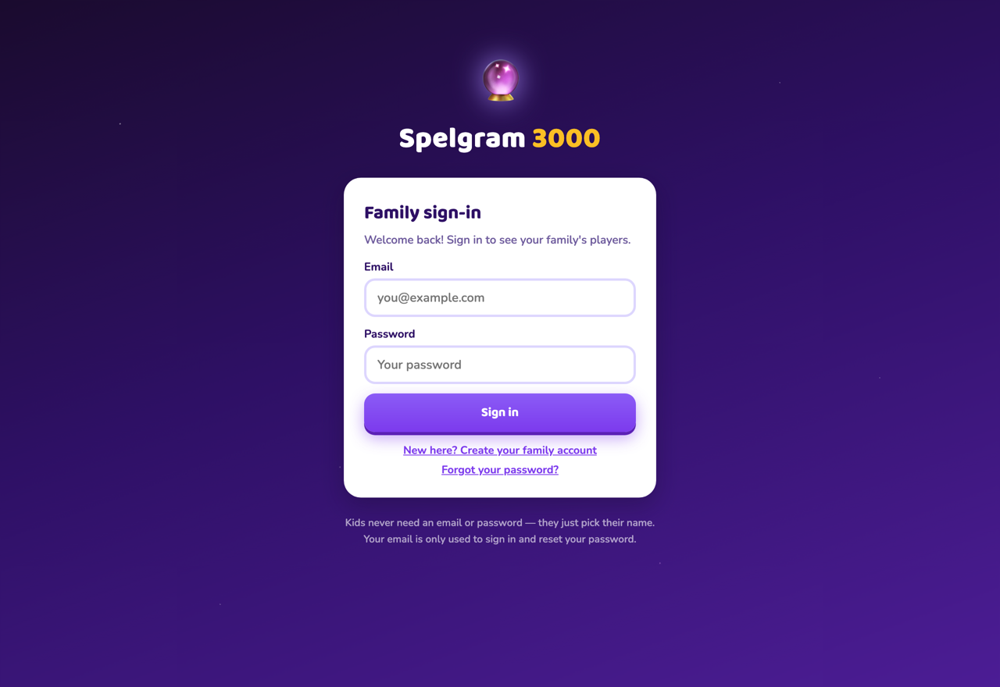
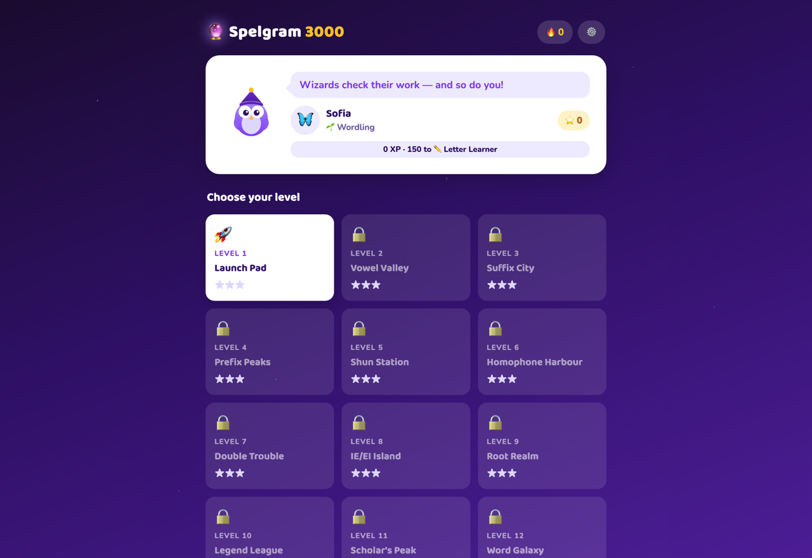

# Spelgram 3000 🔮

A gamified spelling & grammar adventure for Australian students in **Years 5–7**,
aligned to the Australian Curriculum and NAPLAN Language Conventions.

**Version 3.1** — now with **family accounts**, so one public install can serve
many families, each fully separate.

<p align="center">
  
  
</p>

## What's inside

- **Family accounts**: parents create a free account (family name + email +
  password) and stay signed in for 30 days per device. Every family's players,
  progress, parent code and Word Lab live in their own isolated folder on the
  server — no family can ever see another family's kids or stats. Password
  reset works by emailed 6-digit code. Kids **never** need an email or
  password: once the family is signed in, they just tap their name.

- **12 levels** ramping from Year 3 foundations (gentle catch-up) through Year 5/6
  to Year 7 mastery — so the app grows with each child through primary into
  high school.
- **Family profiles**: a "Who's playing?" screen; every child's XP, stars,
  streaks and badges are saved on your hosting and follow them to any device
  the family signs in on.
- **960 core questions** (720 spelling + 240 grammar), every one academically
  verified, plus a **reservoir of 400 bonus items** unlocked through play —
  1,360 in total, with every target word unique across the whole game.
- **🧪 The Word Lab**: kids press one button to "brew" a fresh batch of
  never-seen questions with a fun progress bar. Where the new content comes
  from:
  - With an **Anthropic API key** configured in the parent zone, the Word Lab
    asks Claude to write brand-new curriculum-aligned questions on the spot
    (each is machine-checked before it enters the game — answers verified,
    duplicates rejected).
  - Without a key, it unlocks random batches from the built-in reservoir.
  - Either way the game reshuffles: the engine always serves least-seen items,
    so new content appears in sessions immediately. Kids can refresh once
    every 6 hours; parents can force it anytime.
- **👪 Parent zone**, protected by a 4–8 digit **parent code** (not a
  password — quick to type, hashed on the server, locked for 5 minutes after
  5 wrong tries). The code is asked for **every time** you open the zone: the
  session lives in memory only, so leaving it, reloading, or closing the tab
  all end it — a child can never inherit an open parent session:
  - Per-child dashboard: accuracy, XP, stars, streak, **words to practise**
    (exactly which words they get wrong, how often, at what level) and
    **grammar topics to revisit** — with a **Print** button for a paper
    practice list.
  - Manage players: rename, reset progress, delete (deliberately impossible
    from the kids' screens).
  - Configure the Word Lab "magic key" and change the parent code.
- Everything from earlier versions: Australian voice for listen-and-type,
  NAPLAN-style proofreading questions, hints and rule teaching on every
  question, XP/ranks/badges/confetti, offline resilience.

## Deploying to GoDaddy (Deluxe hosting)

Needs PHP (already on GoDaddy Deluxe). No database — everything lives in a
protected `server-data/` folder the app creates itself.

1. GoDaddy → **My Products → Web Hosting → Manage** → **cPanel** → **File Manager**.
2. Go to `public_html` (or a subfolder like `public_html/spelgram`).
3. Upload the whole project, keeping the structure:
   ```
   index.html
   api.php
   css/  js/  data/
   ```
4. Visit the URL and create your own family account — you're the first user,
   nothing special to configure. First visit to the **Parent zone** asks you
   to create your family's parent code.
5. Optional: in the parent zone, paste an Anthropic API key (create one at
   console.anthropic.com) to turn on AI-generated refreshes **for your own
   family**. The default model is `claude-opus-5` (highest quality); a refresh
   costs roughly US$0.30–0.60. The key is stored server-side only, never shown
   again, and only ever used for the family that configured it — other
   families' Word Labs draw from the free built-in vault unless they add a
   key of their own.

Health check: `yoursite.com/spelgram/api.php?action=ping` → `{"ok":true,...}`.

### Sharing it publicly

The link is now safe to put on your website: every visitor family registers
their own account and gets a private slice of the server. What keeps the
shared host healthy:

- Sign-ups are capped at **500 families** (`MAX_ACCOUNTS` in `api.php`), each
  with up to 20 players and a 256 KB cap per save file.
- Auth endpoints are rate-limited per IP (5 sign-ups and 30 login attempts an
  hour), accounts lock for 10 minutes after 8 wrong passwords, and reset codes
  expire after 15 minutes.
- Session tokens are stored hashed and expire after 30 days without use.

**Password reset emails go out via [Brevo](https://www.brevo.com)** (free
tier is plenty). Create `server-data/mail.json` on the server:

```json
{
  "brevo_key": "xkeysib-your-api-key",
  "from_email": "no-reply@your-domain",
  "from_name": "Spelgram 3000"
}
```

- `brevo_key`: Brevo → profile menu → **SMTP & API → API Keys** → *Generate
  a new API key*.
- `from_email` must be a sender verified in Brevo (**Senders, Domains &
  Dedicated IPs**) — verifying your whole domain gives the best deliverability.

Without `mail.json` (or if Brevo rejects a send — check the PHP error log
for `spelgram send_reset_email`), the app falls back to PHP `mail()` from
`no-reply@your-domain`. If neither works, a locked-out parent can't
self-recover (nothing else breaks) — you can delete their entry from
`server-data/accounts.json` so they can re-register, though their kids'
progress folder would then be orphaned.

### Good to know

- **Backups**: download the `server-data/` folder occasionally — it holds
  every family's accounts, player progress, parent code hashes, and unlocked
  bonus words.
- **Privacy**: kids are first names + avatar only — no email, no password, no
  tracking. Parents' emails are used solely for sign-in and password reset.
  Each family's parent code gates its own management screens, not play.
- **Deleting/renaming players** lives in the parent zone.
- **Word Lab cost control**: without an API key there is zero cost, forever —
  for you and for every family that signs up. A family that adds its own key
  can trigger at most 4 refreshes a day (6-hour cooldown per family). Remove
  a key anytime with the Clear button.
- **Upgrading from v3.0** (single-family): the server layout changed from one
  shared data folder to per-account folders. Register your account first, then
  move your old `server-data/profiles.json`, `save_*.json`, `config.json` and
  `extra-bank.json` into your new `server-data/accounts/<id>/` folder.

## Local preview

```
php -S 127.0.0.1:8642
```

Then http://localhost:8642 (PHP's built-in server runs the app and the API).

## Content layout

- `data/spelling-*.js`, `data/grammar-*.js` — core banks, tagged by level 1–12.
- `data/reservoir-*.json` — locked bonus items the Word Lab unlocks over time.
- `server-data/accounts/<id>/extra-bank.json` — items a family has unlocked or
  AI-generated so far.

Add your own items to any bank following the existing shape — the engine picks
them up automatically.

## License

© 2026 Manuel Re / C31 Labs. Licensed under
[CC BY-NC-ND 4.0](https://creativecommons.org/licenses/by-nc-nd/4.0/):
free to use and share as-is with credit, **no modifications, no commercial
use**. See [LICENSE](LICENSE).
